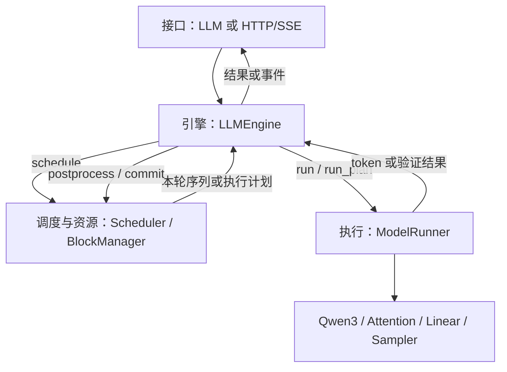

# nano-vLLM 源码解读：AIInfraGuide 对照与本项目补充

目录编排参考 [AIInfraGuide 的 nano-vLLM 栏目](https://caomaolufei.github.io/AIInfraGuide/guides/模块四-推理优化/第3章-nano-vllm源码解读/31-项目全景与四层架构/)。基础部分沿用3.1–3.6的主题；正文按本项目2026-10-26的实际源码独立组织。该网站另外有量化、推测解码章节，本讲义补充的是这些原理在**你这个分支**里的调用、状态和限制。

每次读一节，按“要解决的问题 → 对象与调用 → 小例子 → 源码 → 自查”推进。先读普通separate/TP1路径，再读mixed及实验功能。当前默认值和支持范围以代码、配置校验与对应冻结证据为准；历史报告绑定各自的源码，不能自动套用到当前版本。

## 阅读地图

|节|主题|这一节要交出的东西|
|---|---|---|
|[3.1](#s31)|项目全景与四层架构|一张职责图，能指出谁真正调用GPU|
|[3.2](#s32)|配置、入口与generate流程|一条完整调用链和逐轮状态表|
|[3.3](#s33)|模型骨架与核心算子|一次forward的张量形状变化|
|[3.4](#s34)|KV与BlockManager|逻辑位置到物理slot的手算|
|[3.5](#s35)|调度与连续批处理|解释separate与mixed两条路径|
|[3.6](#s36)|ModelRunner、Graph与基准|区分固定地址、可变内容、图外工作|
|[3.7](#s37)|补充：HTTP/SSE生命周期|一次正常结束和一次取消的回收链|
|[3.8](#s38)|补充：mixed计划与KV事务|reserve、执行、commit/rollback状态图|
|[3.9](#s39)|补充：独立draft与GPU候选|接受/拒绝后target与draft的有效KV表|
|[3.10](#s310)|补充：随机推测概率校正|小词表的接受率与残差分布手算|
|[3.11](#s311)|补充：分层缓存与异步生命周期|为什么复制结束前不能复用目的页|
|[3.12](#s312)|补充：W4A16、Marlin与校准|把checkpoint格式、kernel和质量分开解释|
|[3.13](#s313)|补充：BF16权重布局与可信评测|解释一次正收益，以及为什么流式仍失败|

<a id="s31"></a>
## 3.1 项目全景与四层架构

**先解决的问题：一个模型会forward，为什么还需要推理引擎？**

模型回答“给定这些token，下一位置的logits是什么”；引擎还要决定请求何时进入GPU、KV放哪儿、什么时候结束，以及结果如何交给调用方。把请求想成排队的任务：接入负责登记，引擎推进流程，调度器安排资源，执行器准备数据并计算。

|逻辑层|当前文件|它负责什么|
|---|---|---|
|接口层|`llm.py`、`config.py`、`sampling_params.py`；在线入口还有`server.py`|接收输入、规定配置和请求采样参数|
|引擎层|`engine/llm_engine.py`|协调分词、调度、执行、提交和事件|
|调度与资源层|`scheduler.py`或`planned_scheduler.py`、`sequence.py`、`block_manager.py`|选择本轮任务，管理请求状态及KV页所有权|
|执行层|`model_runner.py`、`models/qwen3.py`、`layers/`|构造GPU输入，执行模型、写KV、计算logits及采样|



这是职责划分；四层不等于四个进程。实际由Engine分别调用调度器和执行器。TP1普通服务里，后台worker是推进引擎的线程，GPU张量和Python元数据仍有各自的所有者。

从一个prompt开始，先在纸上标出三类状态：

```text
Sequence：这条请求有哪些token，已处理多少，是否结束？
BlockManager：它占哪些物理页，有没有共享或尚未提交的预留？
ModelRunner：真正的GPU权重、KV大张量、输入缓冲和Graph。
```

源码入口：[LLM](../../nanovllm/llm.py#L9)、[LLMEngine.step](../../nanovllm/engine/llm_engine.py#L358)、[Scheduler.schedule](../../nanovllm/engine/scheduler.py#L92)、[ModelRunner.run](../../nanovllm/engine/model_runner.py#L534)。

**自查：**为什么`BlockManager.allocate`不能代替Attention写入真实K/V？如果只看`models/qwen3.py`，会漏掉哪些请求生命周期问题？

<a id="s32"></a>
## 3.2 配置、入口与一次generate的全流程

**先解决的问题：哪些东西在引擎启动时决定，哪些属于一条请求？**

`Config`决定全局资源与后端，例如KV页大小、上下文上限、batch预算、Graph、draft模型。`SamplingParams`决定请求的生成方式，例如temperature、max_tokens、EOS/stop和推测方式。当前版本允许`temperature=0`的greedy；普通采样还包含top-k/top-p等字段。随机推测有更窄的限制，见3.10。

`LLM`继承`LLMEngine`，`llm.py`本身没有再实现一套主循环。读离线入口时沿着：

```text
LLM(model, **config)
  → Config校验 → tokenizer → ModelRunner初始化
  → GPU权重、warmup、KV容量与Graph
  → 构造相应Scheduler

generate(prompts, sampling_params)
  → add_request → Sequence → scheduler.add
  → 循环step
  → schedule → ModelRunner.run → postprocess
  → 收集完成结果，按输入顺序返回
```

字符串prompt会在`add_request`内编码；调用方也可以提供token IDs。聊天模板需按实际入口处理：HTTP chat接口会处理messages，普通字符串generate不会自动把任意文字变成聊天对话。

用prompt5token、最多输出3token、无EOS/stop、无前缀命中追踪：

|边界|总token数|有效KV数|输出数|
|---|---:|---:|---:|
|刚入waiting|5|0|0|
|prefill结束，提交t1|6|5|1|
|输入t1，提交t2|7|6|2|
|输入t2，提交t3，释放前|8|7|3|
|请求完成、归还页后|8|0|3|

`t1`是模型预测出的ID，尚未成为模型输入，因此当时没有它的KV。一般无提前终止时，最多需要KV的位置数是`prompt_tokens + max_new_tokens - 1`。

源码入口：[Config](../../nanovllm/config.py#L17)、[SamplingParams](../../nanovllm/sampling_params.py#L8)、[LLMEngine.__init__](../../nanovllm/engine/llm_engine.py#L39)、[LLMEngine.generate](../../nanovllm/engine/llm_engine.py#L892)、[LLMEngine.add_request](../../nanovllm/engine/llm_engine.py#L215)。逐行细读接[请求生命周期讲义](01-request-lifecycle.md)。

**练习：**prompt7token、chunk3、输出2token，分别写出每轮query数、cached数和首次产生输出的轮次。中间prefill chunk不产生completion。

<a id="s33"></a>
## 3.3 模型骨架与核心算子

**先解决的问题：调度器给出的token，怎样变成下一token的分数？**

把本轮展平后的query数记作T，hidden_size记作H，词表大小记作Vocab。这里T是本轮输入行数，既不是完整上下文长度，也不总等于请求数；Vocab与Attention的Q/K/V里的value V也不是同一个量。

```text
input_ids[T]
→ Embedding → hidden[T,H]
→ 多层Decoder：Norm → Attention → 残差/Norm → MLP
→ 最终Norm → 所需位置的LM head → logits[输出位置数,Vocab]
→ Sampler → token IDs
```

Attention内再拆一层：

```text
hidden → 合并QKV投影 → 拆Q/K/V
→ Q/K Norm（取决于模型配置）→ RoPE
→ 新K/V写入slot_mapping指定位置
→ 使用实际可见历史计算Attention → o_proj
```

原始QKV为逻辑切片，随后整理成`[T, heads, head_dim]`。Q heads和KV heads可以不同，所以不要把三者都写成`[T,H]`后就认为它们的head数相同。MLP的gate/up合并投影后，通过SiLU与逐元素乘法，再做down投影。

KV缓存复用的是历史K/V激活；当前token仍要做投影、Attention和MLP。Column/Row Parallel说的是权重切分及相应通信，不是把矩阵存成列主序；与3.13的物理stride变化要区分。

源码入口：[Qwen3DecoderLayer.forward](../../nanovllm/models/qwen3.py#L218)、[Qwen3Attention.forward](../../nanovllm/models/qwen3.py#L97)、[Qwen3MLP.forward](../../nanovllm/models/qwen3.py#L159)、[Attention.forward](../../nanovllm/layers/attention.py#L133)、[ParallelLMHead.forward](../../nanovllm/layers/embed_head.py#L68)、[LinearBase.project](../../nanovllm/layers/linear.py#L55)。

本分支CUDA RoPE使用`fused_rotary.py`固定运算顺序，避免不同dtype/形状共用编译缓存后的回退改变数值。它不是把CUDA Graph关掉；模型算子的编译与Graph捕获是两个层面。

**练习：**一个请求已缓存100token，本轮decode输入1token。分别写出T、Q长度、Attention可见K长度；再解释为什么MLP不会处理101行hidden。

<a id="s34"></a>
## 3.4 KV Cache与BlockManager

**先解决的问题：逻辑上连续的历史，怎样放进不相邻的物理页？**

初始化时，ModelRunner分配常驻KV张量：

```text
kv_cache[2, layers, physical_blocks, block_size, kv_heads, head_dim]
```

请求到来时，BlockManager主要分配页号、引用和映射。`Block`对象是账本，不装GPU中的K/V数组。

设页大小B，逻辑token位置p：

```text
逻辑页号 = p // B
页内偏移 = p % B
物理页号 = block_table[逻辑页号]
物理slot = 物理页号 * B + 页内偏移
```

例如B=256、页表`[7,2]`，逻辑位置258对应物理slot514。这个slot还要结合layer、KV head、head_dim定位实际元素。`positions=258`仍是逻辑位置，用于RoPE；不能替换成514。

前缀复用还需要内容和父前缀匹配，不能只比较当前页里的token。当前实现用完整块的哈希及token校验；探测到候选不等于已经获得引用。本分支还会保留至少最后一个输入重新forward，以恢复下一位置logits。

释放请求表示解除页使用权，通常不把整个KV tensor清零。旧字节可能仍在显存里；正确性依赖有效长度、页所有权、哈希身份和可见性边界。引用为0与“这块显存全部变0”是两回事。

源码入口：[Sequence](../../nanovllm/engine/sequence.py#L23)、[Block](../../nanovllm/engine/block_manager.py#L35)、[BlockManager.probe_prefix](../../nanovllm/engine/block_manager.py#L119)、[BlockManager.allocate](../../nanovllm/engine/block_manager.py#L507)、[BlockManager.deallocate](../../nanovllm/engine/block_manager.py#L531)、[ModelRunner.allocate_kv_cache](../../nanovllm/engine/model_runner.py#L254)。

**练习：**完成[CPU模板](exercises/01_cpu_exercises.py)中的`physical_slot`和`minimum_kv_blocks`。教学B=4仅用于手算；正式配置仍按代码校验，不能照抄成B=4运行。

<a id="s35"></a>
## 3.5 Scheduler与连续批处理

**先解决的问题：连续批处理到底“连续”在哪里？**

它允许在不同step重新选择活跃请求：一条结束后，另一条可以加入后续batch。它不要求每个请求占一条独立CUDA stream，也不意味着所有请求都必须等最长的一条生成完。

|路径|选择条件|调度输出|这轮工作的特点|
|---|---|---|---|
|普通separate|先学习`batching_mode="separate"`|`seqs, is_prefill`|本轮选P或D；P可被切成chunk|
|planned mixed|引擎判断mixed且TP1/model-dtype KV可用|`ExecutionPlan`|可按计划组合P+D或V+D，约束由计划类校验|

具体路径由`LLMEngine._packed_enabled`及配置校验共同决定，查看`runtime_metrics()['effective']`确认实际生效方式。开关写成mixed不等于所有TP/dtype组合都进入mixed。

在普通路径，长prompt可以分成多个chunk；第一次建立的页表可能覆盖prompt所需页，而本轮只写其中一部分。`num_scheduled_tokens`描述本轮query数，`num_cached_tokens`描述已完成的有效前缀。最后一个prefill chunk执行前，请求就可能被预先移入running；这只是调度安排，GPU尚未完成写入。

当前普通调度还通过`max_prefill_steps`等约束避免连续P长期饿死D。显存不足时可抢占请求，归还KV后将它放回waiting重算。Token budget是本轮输入token预算；P的多行、D的一行、V的多行都要计入对应路径的预算。

源码入口：[LLMEngine.step](../../nanovllm/engine/llm_engine.py#L358)、[Scheduler.schedule](../../nanovllm/engine/scheduler.py#L92)、[Scheduler.postprocess](../../nanovllm/engine/scheduler.py#L210)、[PlannedScheduler.schedule_plan](../../nanovllm/engine/planned_scheduler.py#L172)、[ExecutionPlan](../../nanovllm/engine/execution_plan.py#L59)。

**练习：**A还剩5个prompt输入，B等待decode，本轮预算4。先按separate写出可能的P轮和D轮；读到3.8后再写mixed计划。把策略选择和数学上“能否组成同一个tensor”分开说明。

<a id="s36"></a>
## 3.6 ModelRunner、CUDA Graph与性能基准

**先解决的问题：Graph重放时，token和位置变化了，为什么仍能运行？**

Graph固定捕获的算子、依赖和所引用的内存地址。每次重放前，可以更新这些固定缓冲区里的token、position、页表和有效长度。替换Python变量指向一个新tensor，不会自动修改图里的旧地址。

普通执行按以下顺序读：

```text
prepare_prefill / prepare_decode
→ 设置Context（slot、长度、页表；positions另传模型）
→ run_model：eager或已有Graph重放
→ compute_logits → Sampler → 小结果回到CPU
→ finally reset_context
```

本分支普通decode Graph主要覆盖transformer forward；LM head在`run_model`里于重放后计算，采样在`run`里。CPU调度、HTTP及全部提交逻辑没有因此进入同一张Graph。native draft/verification的Graph捕获范围又不同，须分别查看实现。

Graph分桶、页表容量、enforce_eager和未覆盖的形状都可能触发回退。`set_graph_capture_enabled`控制mixed运行时捕获策略，不等于全局开关所有Graph。更大的捕获覆盖还可能增加显存和启动成本。

读同步时，把两类依赖分开：CPU不需要的GPU值可以留在设备；需要给客户端发布已提交token时，仍要拿到可验证结果。异步拷贝提交后，CPU读目标数据前必须确认完成。

源码入口：[ModelRunner.prepare_prefill](../../nanovllm/engine/model_runner.py#L344)、[ModelRunner.prepare_decode](../../nanovllm/engine/model_runner.py#L430)、[ModelRunner.run_model](../../nanovllm/engine/model_runner.py#L485)、[ModelRunner.capture_cudagraph](../../nanovllm/engine/model_runner.py#L654)、[set_context](../../nanovllm/utils/context.py#L68)、[MetadataBuffers](../../nanovllm/engine/metadata_buffers.py#L15)。

**练习：**在源码中圈出Graph输入的“分配一次”和“每次填内容”；找出缺bucket时的回退分支。解释为什么一次`.item()`可能等待之前排队的大量计算，而不仅是复制4字节。

<a id="s37"></a>
## 3.7 本项目补充：HTTP/SSE与请求结束

**问题：离线generate能返回，为什么在线服务还会泄漏或卡住？**

在线请求还包含公开ID、事件队列、客户端读速、取消、超时及完成记录TTL。它们的生命周期与GPU页并不完全相同。

```text
HTTP handler解析prompt/messages
→ RequestManager.submit → engine.add_request
→ 后台RequestManager._run推进engine.step
→ step_events → _complete_event → 请求的有界事件队列
→ HTTP消费者读队列 → SSE写出 → 完成响应
```

`RequestRecord`是服务侧对象，`Sequence`是推理侧对象；公开字符串ID与内部整数seq_id有关联，但不是同一种标识。submit、step与cancel通过服务锁协调，HTTP线程不会各自无序调用同一个模型。

完成时至少区分：归还KV页、引擎忘记请求、服务保留完成结果、TTL后移除记录。慢客户端触发有界队列/终止处理；客户端取消在安全step边界收口，不是任意时刻强行打断CUDA kernel。已经运行的GPU工作必须在相关资源复用前得到处理。

源码入口：[RequestManager.submit](../../nanovllm/server.py#L108)、[RequestManager._run](../../nanovllm/server.py#L248)、[RequestManager._terminate](../../nanovllm/server.py#L175)、[RequestManager._finish](../../nanovllm/server.py#L166)、[LLMEngine.cancel_request](../../nanovllm/engine/llm_engine.py#L269)、[LLMEngine._make_step_events](../../nanovllm/engine/llm_engine.py#L339)。

**练习：**画出waiting时取消和已输出一次后取消的两条回收链。分别检查队列、KV引用、`engine._requests`、事件和服务记录。结束后仍有TTL记录，是否等于KV没有释放？

<a id="s38"></a>
## 3.8 本项目补充：执行计划与KV预留事务

**问题：计划要用某些GPU页，但forward失败了，怎样恢复？**

mixed路径把调度决策与可变状态分开。`ExecutionItem`保存本轮输入、起始位置、页表快照和需要输出logits的位置；`KVReservation`保存扩页前的账本。计划不把一个可随时变化的Sequence当作GPU执行合同。

```text
probe_prefix（只探测）
→ reserve_to（取得页引用/预留空间）
→ 生成不可变ExecutionPlan
→ 准备输入并执行GPU工作
→ commit_item / BlockManager.commit（发布真实进度）
   或 rollback_plan / BlockManager.rollback（恢复预留账本）
```

预留到位置300并不表示已有300个有效KV。只有执行完成、结果被验证、提交逻辑通过后，才推进有效边界。CPU账本回滚也不会擦除GPU上已写过的字节；旧尾部靠有效长度隔离。若相关GPU操作已入队，归还/复用页之前还需要正确的完成栅栏。

角色P是prefill，D是普通decode，V是target验证。当前计划禁止P和V同plan；多query项在D项之前。不要把mixed理解为任意角色、任意数量都能自由混合。

源码入口：[ExecutionItem](../../nanovllm/engine/execution_plan.py#L17)、[KVReservation](../../nanovllm/engine/block_manager.py#L22)、[BlockManager.reserve_to](../../nanovllm/engine/block_manager.py#L166)、[BlockManager.commit](../../nanovllm/engine/block_manager.py#L218)、[BlockManager.rollback](../../nanovllm/engine/block_manager.py#L263)、[PlannedScheduler.commit_item](../../nanovllm/engine/planned_scheduler.py#L382)、[PlannedScheduler.rollback_plan](../../nanovllm/engine/planned_scheduler.py#L450)、[run_plan](../../nanovllm/engine/packed_runner.py#L163)。

**练习：**分别在reserve前、reserve后GPU执行前、GPU入队后注入纸上故障。哪些场景只恢复CPU账本就够，哪些必须先处理GPU完成？

<a id="s39"></a>
## 3.9 本项目补充：独立draft与GPU候选验证

**问题：一次多提交几个token，代价是哪些额外计算？**

draft模型提出候选，target用真实历史加候选做验证，再由提交逻辑决定用户可见输出。候选还没被验证时，不能直接发给用户。target与draft有独立KV；共用tokenizer映射是必要条件，模型大小比例不是耗时比例。

greedy例子：历史为H，草稿为`[a,b]`，target接受a、拒绝b并返回c，则真实历史变成`H+a+c`。草稿的未接受尾部要裁掉有效性，下一轮补齐真实输入。

```text
全接受并给出bonus d：真实序列 H+a+b+d
draft提议时通常只forward到 H+a
→ b和d都还缺draft KV，下一轮会有Q2补算
```

更准确地说，target提交后也通常保留一个尚未forward的新token，用下一轮恢复logits。要分别写target与draft的有效输入历史，不能只画一条“总KV长度”。

旧路径会先把草稿ID回传CPU，再安排target验证。新增可选协议先预留target页，候选保持在GPU，经同stream送入验证输入；最后合并回传候选与预测证据，再物化为普通提交项，沿用既有接受、EOS/stop和裁剪逻辑。它减少一次前置同步，没有把接受提交全部搬到GPU，也没有使两个模型自动并行。

源码入口：[DraftProposer.propose](../../nanovllm/engine/proposer.py#L61)、[DraftProposer.synchronize](../../nanovllm/engine/proposer.py#L40)、[DraftRunner._rollout](../../nanovllm/engine/draft_runner.py#L205)、[DraftRunner.begin_device_proposal](../../nanovllm/engine/draft_runner.py#L283)、[DeviceVerificationItem](../../nanovllm/engine/device_draft.py#L7)、[PlannedScheduler.upgrade_device_verification](../../nanovllm/engine/planned_scheduler.py#L339)、[ModelRunner.run_device_verification](../../nanovllm/engine/model_runner.py#L551)。

当前native draft保留TP1、单活跃请求、mixed、fixed-policy限制，并排除CPU分层KV组合；GPU候选直连仅为受限greedy配置。随机路径另见3.10。支持原理不等于支持任意组合，先读Config约束。

**练习：**K=2时分别推演首位拒绝、第二位拒绝和全接受+bonus。逐项填写：输出序列、target有效KV、draft有效KV、下一轮需要补的输入。

<a id="s310"></a>
## 3.10 本项目补充：随机推测的概率校正

**问题：greedy的“候选相同就接受”，为什么不能直接用于随机采样？**

随机版本需要草稿实际采样分布q和target实际采样分布p，两者条件历史必须一致。候选x从q采出，接受概率为`min(1,p(x)/q(x))`；首次拒绝后从`normalize(max(p-q,0))`采correction；全接受后从下一位置的target分布采bonus。

小词表例子：

```text
词表          [A,   B]
q             [0.8, 0.2]
p             [0.5, 0.5]
A被提出时接受率 = 0.5/0.8 = 0.625
B被提出时接受率 = 1
拒绝残差max(p-q,0) = [0,0.3] → correction必为B
最后A的概率 = 0.8*0.625 = 0.5
```

不能先argmax得到候选，再把softmax当作q。q必须是候选真正来自的过程。验收比较目标分布与统计性质，不要求相同seed在两种不同采样实现中给出同一文本。

本实现保留独立的draft/acceptance/target RNG域，用FP64归一化和CDF进行有限精度校正，并在发布前检查错误packet。temperature-only是当前限制；top-k/top-p/penalty组合不支持时会报错。概率校正不修复BF16形状相关数值差异，也不意味着速度提升；不要把3.9的greedy GPU候选协议直接接进来就称为已支持。

源码入口：[make_generators](../../nanovllm/engine/speculative_sampling.py#L48)、[temperature_probabilities](../../nanovllm/engine/speculative_sampling.py#L117)、[sample_draft](../../nanovllm/engine/speculative_sampling.py#L162)、[speculative_correction](../../nanovllm/engine/speculative_sampling.py#L193)、[CorrectionResult.to_host](../../nanovllm/engine/speculative_sampling.py#L179)、[stochastic_draft.py](../../nanovllm/engine/stochastic_draft.py)。

**练习：**交换p/q中的两行，再手算残差；解释为什么要覆盖零概率、首位/中途拒绝与全接受，而不只检查生成文本是否“合理”。

<a id="s311"></a>
## 3.11 本项目补充：GPU–CPU分层前缀缓存

**问题：GPU页不够了，已经算过的前缀是否只能重新算？**

GPU前缀缓存把可复用的KV保留在GPU页中。CPU层则可保存完整前缀页；之后命中时，把它恢复到已取得使用权的GPU页。只有恢复传输及生命周期成本低于重算，端到端才可能获益；无复用负载是必要负对照。

```text
GPU旧页 → D2H完成 → 发布CPU缓存身份
请求前缀命中 → 取得目的GPU页及lease
→ 提交H2D → COPYING_IN
→ 等待/检查event完成 → 允许Attention消费
→ 解除传输lease；请求的页引用另算
```

这是解释用的状态图，`COPYING_IN`描述在途状态，不要求源码一定用同名Enum。当前异步版本主要预取H2D，D2H仍有同步成本。即使请求已取消，只要H2D还可能写目的页，传输持有的lease仍不能被忽略，否则新请求会读到或被覆盖成旧数据。

缓存key包含完整前缀链与引擎namespace；它不提供跨引擎持久化或引擎内多租户隔离。`non_blocking=True`只表示允许异步提交，不能单靠这个参数宣布计算/传输已重叠或产生收益。

源码入口：[HostPrefixCache.put](../../nanovllm/engine/tiered_cache.py#L51)、[AsyncHostPrefixCache.load](../../nanovllm/engine/tiered_cache.py#L128)、[AsyncHostPrefixCache.wait_for_blocks](../../nanovllm/engine/tiered_cache.py#L150)、[BlockManager.reap_host_loads](../../nanovllm/engine/block_manager.py#L107)、[LLMEngine._step_legacy](../../nanovllm/engine/llm_engine.py#L369)。

**练习：**A请求的H2D未完成就取消，B请求想复用目的页。画出哪些引用属于A、哪些属于传输，event完成之前B能否写这页？

<a id="s312"></a>
## 3.12 本项目补充：W4A16、Marlin与校准评测

**问题：“加载了INT4权重”与“真正执行量化kernel”有什么区别？**

先分开三层：checkpoint规定packed整数、scale、zero-point及分组；loader把这些内容放进模型的合并QKV/gate-up布局；执行后端读取正确布局并完成乘加。本项目支持范围是显式AWQ格式及受限dense Qwen3/TP1配置；不要把可研究的GPTQ格式说成当前loader都已支持。

Marlin是量化矩阵乘执行kernel/布局相关实现，不是一个自动消除量化误差的模型或校准算法。当前sidecar会校验扩展库与元数据，预处理成其执行所需布局，并处理Graph所需workspace。量化训练/校准与运行时kernel是不同工作。

先用`w≈scale*(q-zero)`理解反量化：同一组scale=0.25、zero=8时，整数9表示约0.25，整数7表示约-0.25。真实checkpoint还规定分组轴和位打包顺序；不能只按这个公式猜loader布局。

```text
AWQ checkpoint
→ validate_awq_config / weight_loader
→ QKV、gate/up各分片映射及加载完成检查
→ prepare_marlin / MarlinAWQState
→ AWQPackedLinear.forward进入真实量化执行路径
```

W4A16里W描述权重，A描述激活；本项目AWQ路径要求FP16激活/scales。KV dtype是另一条轴：FP8 KV不表示权重或激活已经量化。把全模型反量化为BF16后用普通F.linear，只能作为参考，不是这里的量化加速交付。

定位质量问题按三个比较拆开：同checkpoint的dense参考与Marlin；原始浮点checkpoint与量化checkpoint；相同历史下的logits/KL及自由生成/接受率。前者定位加载和kernel，后两者才涉及量化误差及草稿对target的匹配。

TRAIN用于拟合，DEV执行冻结停止规则，最终验证只验收。NLL、完整词表KL、各类接受率和端到端时间分别记录；NLL改善不必提高对特定target的接受率。量化target改变参考模型分布，量化draft还可能改变接受率；两种情形不能合并宣传。

源码入口：[configure_weight_format](../../nanovllm/utils/quant_config.py#L5)、[load_model](../../nanovllm/utils/loader.py#L18)、[AWQPackedLinear.weight_loader](../../nanovllm/layers/awq_packed.py#L117)、[AWQPackedLinear.forward](../../nanovllm/layers/awq_packed.py#L159)、[MarlinAWQState](../../nanovllm/layers/awq_marlin_sidecar.py#L88)、[质量工具](../../benchmarks/evaluate_w4_quality.py)。

当前量化draft未获得可推荐结论；W4A4、MTP、MoE及多卡draft不在已交付范围。具体质量与场景限制查询各自冻结报告，不能由本讲义推导出“全部量化配置更快”。

**练习：**同一AWQ checkpoint的dense参考与Marlin一致，但二者都比浮点draft接受率低。应优先排查哪一层？为什么不能靠放宽质量阈值解决？

<a id="s313"></a>
## 3.13 本项目补充：BF16物理布局与可信性能结论

**问题：改变权重布局，与量化、TP切分有什么不同？**

最近保留的`stable_linear_packed`只改变BF16 dense target的物理存储：逻辑权重仍为`W[N,K]`，stride从`[K,1]`变成`[1,N]`，kernel按新的地址计算同一个`X @ W.T`。权重字节数、精度和固定K分块没有因此缩小；“packed”在这里不是INT4位打包。

重排在加载后、warmup/KV预算/Graph捕获前完成。Embedding和LM head保留原布局。Graph捕获后再随意替换weight storage会破坏固定地址假设，不能把启动期选项当作运行中随时切换的开关。

源码入口：[pack_stable_linears](../../nanovllm/layers/stable_layout.py#L46)、[packed_stable_bf16_linear](../../nanovllm/layers/stable_layout.py#L25)、[LinearBase.project](../../nanovllm/layers/linear.py#L55)、[ModelRunner._initialize](../../nanovllm/engine/model_runner.py#L93)。

评测要回答不同问题，不能只报一个token/s：

|检查|证明什么|不能替代什么|
|---|---|---|
|同执行路径有效KV|缓存状态是否一致|不同query形状的算术一致性|
|固定共同历史logits|相同条件下数值差异|自由生成最终文本|
|token/提交/终止检查|用户可见结果与生命周期|有损量化的统计质量|
|接受/提议/验证次数|推测有效工作量|GPU执行成本和同步成本|
|TTFT、事件间隔、吞吐|不同用户体验维度|彼此之间的达标结论|
|五轮同卡交错对照|限定负载下稳定收益|未测试模型、并发或上下文|

最近一轮，普通consistent、draft K1/K4的同配置增量配对速度比分别约1.0659/1.0562/1.0421。但K1事件间隔20.90ms对**同样优化后的普通**17.92ms，仍高约16.6%。不能保留旧普通19.23ms作唯一基线来宣称流式达标。普通Torch还有不同算术路径，不能把它与consistent的结果说成逐位等价。

原始数据、分组失败、显存和启动成本见[最新优化报告](../results/DRAFT_OPTIMIZATION.md)。新增实验开关默认关闭。当前已停止扩大参数/校准网格；没有把这些结果解释成已达到硬件性能上限。

**练习：**一个优化同时加速target普通decode和verification，draft自身耗时不变。为什么draft的绝对事件间隔下降了，相对普通decode的比例却可能变差？

## 当前学习的完成标准

先完成3.1–3.2及既有CPU练习，再按顺序推进。每节留下三样东西：自己画的调用/状态图、标注实际函数的解释、一个可手算或可复现的小例子。遇到扩展开关时先确认支持范围，不把实验配置当作默认主线。

读完基础六节，你应能从HTTP或generate入口，追到waiting/running、KV分配、输入张量、模型forward、采样、提交和回收。扩展部分再回答“为了缓存、draft或量化，多维护了哪些状态和不变量”。

## 原文章节索引

本讲义采用相同基础主题顺序，实际类、函数、开关与支持范围以本分支为准。

- [3.1 项目全景与四层架构](https://caomaolufei.github.io/AIInfraGuide/guides/%E6%A8%A1%E5%9D%97%E5%9B%9B-%E6%8E%A8%E7%90%86%E4%BC%98%E5%8C%96/%E7%AC%AC3%E7%AB%A0-nano-vllm%E6%BA%90%E7%A0%81%E8%A7%A3%E8%AF%BB/31-%E9%A1%B9%E7%9B%AE%E5%85%A8%E6%99%AF%E4%B8%8E%E5%9B%9B%E5%B1%82%E6%9E%B6%E6%9E%84/)
- [3.2 配置、入口与generate流程](https://caomaolufei.github.io/AIInfraGuide/guides/%E6%A8%A1%E5%9D%97%E5%9B%9B-%E6%8E%A8%E7%90%86%E4%BC%98%E5%8C%96/%E7%AC%AC3%E7%AB%A0-nano-vllm%E6%BA%90%E7%A0%81%E8%A7%A3%E8%AF%BB/32-%E9%85%8D%E7%BD%AE%E5%85%A5%E5%8F%A3%E4%B8%8E%E6%8E%A8%E7%90%86%E4%B8%BB%E5%BE%AA%E7%8E%AF/)
- [3.3 模型骨架与核心算子](https://caomaolufei.github.io/AIInfraGuide/guides/%E6%A8%A1%E5%9D%97%E5%9B%9B-%E6%8E%A8%E7%90%86%E4%BC%98%E5%8C%96/%E7%AC%AC3%E7%AB%A0-nano-vllm%E6%BA%90%E7%A0%81%E8%A7%A3%E8%AF%BB/33-%E6%A8%A1%E5%9E%8B%E4%B8%8E%E6%A0%B8%E5%BF%83%E7%AE%97%E5%AD%90/)
- [3.4 KV Cache与BlockManager](https://caomaolufei.github.io/AIInfraGuide/guides/%E6%A8%A1%E5%9D%97%E5%9B%9B-%E6%8E%A8%E7%90%86%E4%BC%98%E5%8C%96/%E7%AC%AC3%E7%AB%A0-nano-vllm%E6%BA%90%E7%A0%81%E8%A7%A3%E8%AF%BB/34-kvcache%E4%B8%8Eblockmanager/)
- [3.5 Scheduler与连续批处理](https://caomaolufei.github.io/AIInfraGuide/guides/%E6%A8%A1%E5%9D%97%E5%9B%9B-%E6%8E%A8%E7%90%86%E4%BC%98%E5%8C%96/%E7%AC%AC3%E7%AB%A0-nano-vllm%E6%BA%90%E7%A0%81%E8%A7%A3%E8%AF%BB/35-scheduler%E4%B8%8E%E8%BF%9E%E7%BB%AD%E6%89%B9%E5%A4%84%E7%90%86/)
- [3.6 ModelRunner、CUDA Graph与性能基准](https://caomaolufei.github.io/AIInfraGuide/guides/%E6%A8%A1%E5%9D%97%E5%9B%9B-%E6%8E%A8%E7%90%86%E4%BC%98%E5%8C%96/%E7%AC%AC3%E7%AB%A0-nano-vllm%E6%BA%90%E7%A0%81%E8%A7%A3%E8%AF%BB/36-modelrunner%E5%BC%95%E6%93%8E%E5%BE%AA%E7%8E%AF%E4%B8%8E%E6%80%A7%E8%83%BD/)
