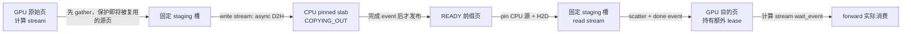

# 成本感知缓存与有界批量传输

本轮针对 CPU/GPU 前缀缓存增加两个独立、默认关闭的实验功能：成本感知准入/回载，以及有界批量异步 D2H/H2D。原同步缓存、原异步 H2D 和 GPU-only 路径均保留。五轮正式测量与自然容量负对照均已完成，新增配置未达到增量收益门槛，保持默认关闭。

## 支持范围与正确性边界

- dense Qwen3、TP1、模型原 dtype 的 KV、前缀缓存开启、推测策略关闭。
- 正式性能配置：Qwen3-1.7B BF16，单张 RTX 4090，Torch linear/default 数值路径、Triton RMSNorm、复用 metadata，decode CUDA Graph 保持开启。
- separate 调度为正式性能范围；mixed 额外完成真实模型正确性检查，不沿用 separate 的性能结论。
- 本轮端到端口径为引擎接收冻结 token 请求、排队、调度、采样和生成事件的完整耗时；不包含 HTTP 网络。本轮输入是独立分割的合成缓存压力轨迹，结果不代表真实会话分布。
- 仅缓存可复用的完整前缀页；不实现活跃请求 KV 的通用换出、多机 KV、SSD 层或跨引擎共享。
- 新路径不能与量化或 draft 任意组合；配置会提前拒绝本轮未支持的组合。

原门槛保持：共同历史 logits `atol=rtol=0.01`，同路径有效 KV 逐位相等，自由生成逐 token 对照；配对中位加速至少 1.03 倍、五轮均更快，p95 TTFT/真实事件间隔比值均不超过 1.10。另保留 TTFT 1000 ms、摊销 TPOT 30 ms 的绝对 SLO，队列时间不扣除。

DEV 已发现一个既有数值问题：burst 第 10 号请求在 GPU-only 与原同步 CPU 缓存之间，最后 prefill 的总 Q 为 129/2，首次 decode 的 batch 为 1/2。该请求自身均从零重算前缀；共同历史下 logits 最大差 0.125，超过原门槛，第二个 token 发生分歧。所有新缓存路径与原同步缓存输出一致。跨路径差异保留为 `REVIEW_REQUIRED`，不得用缓存对照通过来宣称与 GPU-only 全面一致，也不得仅凭计时推荐默认配置。

## 改了什么，为什么这样改

### 成本感知准入和回载

入口为 `nanovllm/engine/cache_cost.py`。

`CacheCostModel` 从离线校准读取真实 `(本轮Q, 已有K)` 的 prefill wall time，以及不同页数的 H2D/D2H 完成耗时。按实际 chunk 累加计算重算成本，避免仅按 token 数估算。校准绑定 checkpoint 配置、dtype、数值/线性/RMSNorm 后端、页/chunk 大小、物理 GPU UUID 和批量布局；更换这些条件需要重新校准。

准入比较：`预计后续复用次数 × (每页摊销重算节省 − H2D成本) − D2H成本 > 0`。已执行的不同请求提供复用观测；历史表使用有界 LRU，默认 4096 项。未完成模型 forward 的请求不会计热度。尚无足够观测时使用 calibration split 的单个全局首次复用先验，不读取 DEV/正式结果。

回载比较：`保留GPU已有前缀后继续重算的成本 − CPU回载后剩余计算成本 > 回载成本`。已排队传输也计入成本，拒绝回载时不分配目的页、不发布虚假命中。没有假定异步复制一定被计算完全隐藏。

第一版硬性要求两次观测才准入，DEV pooled 相对原同步路径仅 0.9336 倍。它漏掉了昂贵前缀的第一次复用。正式测量前改为 calibration-only 的 `58/126` 首次复用先验，保留原负结果与协议修订。它仍是简单成本启发式，并非已证明能适应任意流量的学习策略；本轮没有实现成本驱动的淘汰排序。

### 有界批量异步传输

入口为 `nanovllm/engine/cache_transfer.py` 和 `nanovllm/layers/kv_transfer.py`。

旧布局一页分散在 K/V 和各模型层中。新路径不改变 Attention 的 KV 布局，用小型 Triton gather/scatter 将至多 4 页聚合到固定 staging，再执行连续 DMA。偏移使用 int64，掩码覆盖非整齐尾部，搬运不做 dtype 转换或数值运算。

固定 2 个 staging 槽，每槽 4 页，CPU 使用有界 pinned slab。staging 在 GPU KV 容量预算前分配，不能在基准中白占显存而不扣 KV 容量。主机 slab 和索引也计入预算。槽满时跳过非必需备份，保留重算路径，不无限追加缓冲区。



源页保护依赖计算 stream 上先 gather 再 forward 的顺序；CPU 发布依赖完成事件。H2D 的 CPU 源 ref 与 GPU 目的 lease 分开保护，请求取消不能提前复用仍在复制的目的页。消费方只建立必要的设备侧等待；清空、退出和异常恢复才执行明确的 host fence。固定缓冲区由 workspace 持有到 fence 后释放，不靠删除真实依赖来减少同步。

## 正确性与原始证据

服务器完整证据根目录：`/home/hrxu/nano-vllm-archive/cache-runtime-20261028-001`，下文简写为 `$R`。

- `source-before.tar.gz`、`snapshot.json`：保留本轮前含未跟踪源码的完整快照；未重置已有学习/说明修改。
- `dependencies.freeze.txt`、`inputs.json`：依赖、模型文件 SHA256、原始 token 输入、calibration/DEV/formal 分离和重叠审计。
- `protocol.json`、`protocol-amendment-001.json`、`protocol-amendment-002.json`、`freeze.json`：实验边界、修订原因和正式冻结指纹。
- `cpu-final/summary.json`：26 套 CPU 回归；其中 `cache-cost` 包括成本方向、队列反转、无分配绕过、历史有界、校准身份和预算检查。
- `transfer-gpu-final.json`：FP16/BF16 位级搬运、非整齐尾部、源页立刻覆盖、复制中取消/目的复用、注入 scatter 故障后的 fence。
- `model-{legacy,batched,combined,mixed}002.json`：真实模型 255/256/257/513/1025-token 边界，擦除 GPU KV 后真实 CPU 回载、共同历史全词表 logits 与有效 KV、跨进程、EOS、取消和异常清理。
- `mixed-engine-{legacy,combined}.json`：额外通过真实 mixed planner 的循环前缀压力轨迹，发生实际 CPU 回载，组合与相同 mixed 原同步路径的全部输出 token 一致；仅验收正确性，不附带 mixed 性能结论。
- `baseline-shape-comparison.json`、`baseline-shape-{gpu,cache}/`：上述既有跨 batch 数值差异的原始 logits/KV/历史与执行形状。
- `dev-first/` 保留准入策略退化；`dev-final/` 保留完整 DEV 和 GPU-only 不一致，不能只摘取成功项。

首次模型测试因测试辅助函数用 inference tensor 构造可复用 metadata，随后在普通模式复用时报错；辅助测试改用 `no_grad` 后通过。原失败文件保留，未改运行时计算或数值阈值。

## 正式结果

五轮六臂已完成：30 个独立进程、每臂 380 个正式请求，共 2280 个正式请求；逐组固定同一物理 GPU3，保留并行主机负载、原始 token/事件和最终传输 drain。所有正式输入自由生成 token 对照一致。

**结论：新增两项实现的增量均未通过 1.03× 且五轮都更快的收益门槛，所有新增配置保持默认关闭。** 正式输入相同不能消除 DEV 中已经复现的跨形状问题；该问题仍需独立处理。

|对照（候选 / 参考）|五轮配对耗时比中位数|更快轮数|TTFT p95 比|真实事件间隔 p95 比|相对门槛|
|---|---:|---:|---:|---:|---|
|仅成本策略 / 原同步缓存|1.0108×|4/5|1.0060|0.9970|失败|
|仅批量传输 / 原同步缓存|1.0100×|4/5|1.0210|1.0064|失败|
|仅批量传输 / 原异步 H2D|0.9963×|2/5|1.0215|1.0043|失败|
|两项组合 / 原同步缓存|1.0111×|4/5|1.0121|1.0054|失败|
|两项组合 / 仅批量传输|1.0054×|4/5|0.9913|0.9989|失败|
|两项组合 / GPU-only|1.2390×|5/5|0.8788|0.1702|通过|

按同一配对定义补充比较，组合 / 原异步 H2D 为 **0.9983×**（各轮：0.9936, 1.0146, 0.9973, 0.9983, 1.0007），同样未形成增量收益。原同步缓存 / GPU-only 已有 1.2254×，原异步 H2D / GPU-only 已有 1.2341×。不能把组合相对 GPU-only 的收益全部归为本轮贡献。

|配置|各轮总体吞吐中位数 token/s|TTFT p95 ms|事件间隔 p95 ms|绝对 SLO 达标请求|LLM 构造中位数 s|Torch allocated 峰值 MiB|Torch reserved 峰值 MiB|
|---|---:|---:|---:|---:|---:|---:|---:|
|GPU-only|57.61|4873.74|33.576|87/380|2.271|3664.55|3744.00|
|原同步缓存|70.18|4231.61|5.683|88/380|2.311|3682.53|3772.00|
|原异步 H2D|70.83|4229.48|5.695|89/380|2.273|3682.53|3800.00|
|仅成本策略|70.96|4257.12|5.666|90/380|2.319|3682.53|3772.00|
|仅批量传输|70.73|4320.52|5.720|89/380|2.997|3888.55|3968.00|
|两项组合|70.88|4282.86|5.713|89/380|3.013|3888.55|3968.00|

吞吐列为各配置自己的中位数，验收列使用同轮配对耗时比的中位数，二者不应混算。p95 包含入口排队，绝对 SLO 明显未通过；保留原失败结论。启动列计量 LLM 构造，Python 导入不在该计时内；系统文件页缓存及已有编译缓存为热态，没有清理共享编译缓存来冒充完整冷启动测量。显存是 Torch allocator 实测峰值，CUDA context/驱动等额外开销见原始环境快照，不把它称为 NVML 总进程峰值。

分组保留（组合相对 GPU-only 是容量收益，右列才是相对原同步缓存的新增贡献）：

|负载|组合 / GPU-only|组合 / 原同步缓存|新增组合是否过相对门槛|
|---|---:|---:|---|
|cyclic|1.5044×|1.0208×|失败|
|session|1.3478×|1.0035×|失败|
|branch|0.9964×|1.0012×|失败|
|unique|0.9808×|1.0103×|失败|
|burst|1.4777×|1.0283×|失败|

自然自动 KV 容量五轮负对照：组合 / GPU-only **0.9893×**，更快 0/5 轮，TTFT p95 比 1.0063、事件间隔 p95 比 1.0066，token 一致=True。GPU-only 物理 KV 页数 [592, 592, 592, 592, 592]，组合为 [584, 584, 584, 584, 584]。staging 已从实际容量预算扣除；工作集能留在 GPU 时没有稳定加速。

组合固定 staging 约 **224 MiB**，两槽×四页；host pinned slab+索引约 **1008 MiB**，预算 1 GiB。压力场景实测 allocated 峰值相对原同步缓存增加 **206.02 MiB**，LLM 构造中位数增加 **0.703 s**。新增依赖为零，复用项目已有 PyTorch/Triton。

独立 profiler 的传输/主机等待归因见 `$R/PROFILE_ANALYSIS.md` 和 `profile-summary.json`。校准表显示相同字节量的完成耗时没有变快：旧 D2H 一/二/四页约 1.32/2.69/5.12 ms，新路径约 1.54/2.74/5.20 ms；减少分配和同步并不自动形成端到端收益。不能把 profiler 中的变化替代正式五轮判定。

Profiler 使用 8 个 DEV 循环请求、每个输出 2 token，和正式计时分进程。按大于等于 1 MiB 的 KV payload 过滤：

|路径|H2D/D2H payload DMA 次数|cudaEventSynchronize|cudaStreamSynchronize|新增 gather/scatter GPU 总时间|
|---|---:|---:|---:|---:|
|原同步缓存|10 / 10|20 次，self CPU 22.55 ms|60 次|0|
|仅批量传输|4 / 4|0 次|60 次|1.034 ms|
|两项组合|4 / 4|0 次|60 次|1.033 ms|

每个方向仍传 280 MiB；DMA 次数减少 60%，传输字节数不变。新路径减少了这一诊断 trace 内的 30 次 `aten::empty`，模型本身的大量分配及采样/边界同步仍存在。这个结果解释了工程改动确实生效，但不能证明带宽变快或全部同步已消失。

新增功能只作为可运行、可回归的实验实现交付。继续使用当前已验收普通服务；已有缓存配置仍按其历史限定范围解释，不升级为通用生产配置。所有结论与原始证据保存在 `$R/formal-analysis.json`、`normal-capacity-analysis.json`、`additional-paired.json`。

## 直接复现

以下复现冻结 candidate，不改已有证据；所有输出必须用新路径。GPU3 是本轮物理卡，重新运行前仍需确认稳定空闲，不能停止他人任务。换卡需重做校准与冻结。

```bash
export R=/home/hrxu/nano-vllm-archive/cache-runtime-20261028-001
export PY=/home/hrxu/nano-vllm/.venv/bin/python
export CUDA_VISIBLE_DEVICES=GPU-cffbe123-7f3a-fa27-4919-047ba4dd4790
export NANOVLLM_BENCH_GPU_INDEX=3
export HF_HUB_OFFLINE=1 PYTHONDONTWRITEBYTECODE=1
cd "$R/candidate"

# 无 GPU 的回归；不把它当作 GPU 验收
CUDA_VISIBLE_DEVICES='' "$PY" -B -m tests run extended --output "$R/repro-cpu-001"

# 传输状态与位级一致性
"$PY" -B -m tests.regression.check_cache_transfer_gpu --gpu --output "$R/repro-transfer-001.json"

# 新进程严格对照原路径，含真实回载与 256-token 边界
"$PY" -B -m tests.regression.check_cache_runtime_gpu --backend legacy --output "$R/repro-legacy-001.json"
"$PY" -B -m tests.regression.check_cache_runtime_gpu --backend batched \
  --policy "$R/calibration-final/batched.json" --compare "$R/repro-legacy-001.json" \
  --output "$R/repro-combined-001.json"

# mixed planner 下的实际 CPU 回载联动，仍只检查正确性
PYTHONPATH=. "$PY" -B "$R/check_mixed_cache.py" --root "$R" --variant legacy_sync \
  --output "$R/repro-mixed-legacy-001.json"
PYTHONPATH=. "$PY" -B "$R/check_mixed_cache.py" --root "$R" --variant combined \
  --compare "$R/repro-mixed-legacy-001.json" --output "$R/repro-mixed-combined-001.json"

# 六臂×五轮：自动交错顺序、每臂独立进程、逐组 GPU guard
"$PY" -B -m benchmarks.cache_runtime_experiment suite --inputs "$R/inputs.json" \
  --calibration-dir "$R/calibration-final" --freeze "$R/freeze.json" --output "$R/repro-formal-001"
"$PY" -B -m benchmarks.cache_runtime_experiment analyze \
  --index "$R/repro-formal-001/index.json" --output "$R/repro-formal-001-analysis.json"

# 不人为限制 GPU KV 为12页的负对照，同样五轮
"$PY" -B -m benchmarks.cache_runtime_experiment suite --normal-capacity --inputs "$R/inputs.json" \
  --calibration-dir "$R/calibration-final" --freeze "$R/freeze.json" --output "$R/repro-normal-001"
"$PY" -B -m benchmarks.cache_runtime_experiment analyze \
  --index "$R/repro-normal-001/index.json" --output "$R/repro-normal-001-analysis.json"
```

重新独立校准使用统一工具的 `prepare` → `calibrate --transport legacy` 和 `--transport batched` → DEV `worker` → `freeze` → `suite`。用新的输入文件/校准目录和输出目录；不要编辑 `freeze.json` 或将正式验证结果反馈进校准参数。

在主工作树手动启动实验服务可使用下面的独立命令。先按上文设置本轮 GPU 环境，并确认稳定空闲；此命令是新增实验服务入口，不继承旧冻结启动器的 HTTP 验收结论。

```bash
cd /home/hrxu/nano-vllm
"$PY" -B -m benchmarks.runtime_v2_gpu_guard && \
"$PY" -B serve_nano_vllm.py --host 127.0.0.1 --port 17847 \
  --model /home/hrxu/huggingface/Qwen3-1.7B --tensor-parallel-size 1 \
  --max-model-len 2048 --max-num-seqs 4 --max-num-batched-tokens 256 \
  --prefill-chunk-size 128 --max-prefill-steps 1 --batching-mode separate \
  --speculative-policy off --metadata-backend reuse --rmsnorm-backend triton \
  --gpu-memory-utilization .85 --max-kv-cache-blocks 12 \
  --host-kv-cache-bytes 1073741824 --host-kv-async-prefetch \
  --host-kv-transfer-backend batched --host-kv-transfer-batch-blocks 4 \
  --host-kv-transfer-slots 2 --host-kv-transfer-max-bytes 268435456 \
  --host-kv-cost-model-path "$R/calibration-final/batched.json"
```

只测批量传输时去掉 `--host-kv-cost-model-path`；只测成本策略时将后端改为 `legacy`、去掉异步开关，并使用 `calibration-final/legacy.json`。原同步对照再去掉成本文件；GPU-only 对照将 host budget 设为 0，并去掉成本、异步和 batched 配置。配置证据在 `configs/experiments/cache_{cost,batched,combined}.json`，读取时仅将内部 `config` 传给 `LLM`。

## 阅读顺序

1. `Config` 看支持条件和默认值；`LLMEngine.__init__` 看旧缓存、policy、workspace 如何组合。
2. `BlockManager.observe_cache_request` → `CacheCostPolicy.admit/restore`：热度在哪里更新，绕过回载如何不产生资源副作用。
3. `flush_host_stores` → `put_many` → gather → write-stream：GPU 物理页为什么能安全复用。
4. `restore_host_prefix` → `load_many` → read-stream → `wait_for_blocks` → forward：逻辑命中、复制提交和实际消费的区别。
5. `reap_host_loads` 与 cancel/rollback：额外 lease 怎样独立于请求释放，event 尚未完成时目的页为何不能回到 free list。
6. 最后看三类新测试和 `cache_runtime_experiment`：先校准、再冻结、最后独立验证；先读失败项再读速度数字。

下一轮只在新协议下研究：解决已有跨形状数值问题；更接近真实会话分布的复用概率/过期模型；更长上下文和更低重算成本下重新校准。不能把这些未来工作写成已实现能力。

## 和近期工作的关系

2026-10-15 的预印本 [When the KV Cache Is Slower Than the GPU](https://arxiv.org/abs/2610.21500) 分析了缓存命中仍比重算慢的情形，将有效带宽与引擎固定开销纳入成本。本轮采用同类问题意识，直接测本机重算/传输成本；没有移植其 PCP/MLA/远端多节点实现，也不能沿用它在 B300 上的收益数字。

同日预印本 [Range](https://arxiv.org/abs/2610.21241) 强调逻辑缓存粒度与物理存储/传输批量解耦。本轮只实现单机 CPU/GPU 的固定批量 staging、完成事件与页 lease，未实现 Range 的 SSD/GDS、字节条带或逐层交付，不能称为完整复现。

[LMCache 的分层缓存架构](https://docs.lmcache.ai/developer_guide/architecture.html) 可用作下一步接口设计的参照。本项目仍是边界清楚、可测量的学习型推理引擎；要走向实际服务，应先解决已有数值边界，并在真实会话轨迹和 SLO 下证明收益，再考虑扩存储层或跨进程共享。
